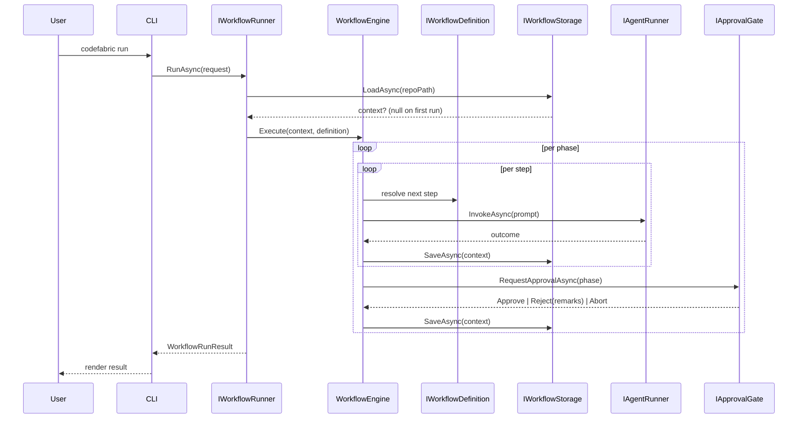

# CodeFabric — High-Level Design

**Version:** 1.0
**Status:** Draft
**Companion documents:** [REQUIREMENTS.md](./REQUIREMENTS.md), [detailed-design.md](./detailed-design.md)

---

## 1. Purpose

CodeFabric is a .NET 10 orchestrator that drives a phase-gated, agent-executed feature
delivery workflow. This document defines the refined high-level architecture that realises
the requirements in [REQUIREMENTS.md](./REQUIREMENTS.md).

The design is deliberately minimal: a thin CLI, a self-contained core engine, and a
swappable storage backend. Workflow-specific knowledge (phases, steps, agents, ordering,
termination rules) is encapsulated in `IWorkflowDefinition` implementations so that the
engine itself stays generic.

---

## 2. Architectural principles

1. **CLI is a thin client.** It only parses arguments, constructs inputs, and calls public
   entry points on `CodeFabric.Core`. It contains no workflow logic.
2. **All logic lives in Core.** The engine, workflow definitions, prompt rendering, loop
   control, approval gates, and the storage *contract* all live in `CodeFabric.Core`.
3. **Storage is abstracted.** Core defines `IWorkflowStorage`; the first implementation
   persists state as a JSON file in the repository. SQLite or other backends can be added
   later without touching the engine.
4. **Workflows are data + definition.** `IWorkflowDefinition` encapsulates everything
   specific to a given workflow type. The engine is workflow-agnostic.
5. **Deterministic spine, agentic execution.** The orchestrator's control flow is fully
   deterministic. Only the *work produced inside each step* is AI-generated.
6. **Resumable by construction.** State is persisted after every transition, so any run
   can be resumed from the last checkpoint.

---

## 3. Solution structure

```
CodeFabric.slnx
├── CodeFabric.Core/       # Engine, workflow definitions, contracts, storage interface
│   ├── Contracts/         # Public API consumed by the CLI
│   │   ├── IWorkflowRunner.cs
│   │   ├── WorkflowRunRequest.cs
│   │   └── WorkflowRunResult.cs
│   ├── Engine/            # Workflow-agnostic orchestration
│   │   ├── IWorkflowDefinition.cs
│   │   ├── WorkflowEngine.cs
│   │   └── ...
│   ├── Definitions/       # Concrete IWorkflowDefinition implementations
│   ├── Agents/            # Agent invocation abstraction
│   ├── Approval/          # Phase-gate approval abstraction
│   ├── State/             # Storage contract + state model
│   └── Prompts/           # Prompt rendering
│
├── CodeFabric.Storage/    # IWorkflowStorage implementations (JSON in v1)
│
└── CodeFabric/            # Thin CLI client
```

**Dependency rule (strictly enforced):**

- `CodeFabric.Core` → BCL only.
- `CodeFabric.Storage` → `CodeFabric.Core`.
- `CodeFabric` (CLI) → `CodeFabric.Core`

**Dependency Injection:**

- All services are registered via `AppBoot` in the CLI project. This enables the implementation of the strict dependency rule

---

## 4. Component responsibilities

### 4.1 CLI (`CodeFabric`)

Responsibilities:

- Parse command-line arguments (`run`, `resume`, `status`, `abort`).
- Prompt the user for the feature description on first run (per requirements §11).
- Configures the `AppBoot` plugins, for now just the `Storage` implementation.
- Invoke `IWorkflowRunner.RunAsync(...)` and render returned progress/results.
- Translate exit outcomes to process exit codes.

Non-responsibilities: no phase/step knowledge, no persistence, no process spawning.

### 4.2 Core — Contracts (`CodeFabric.Core.Contracts`)

The **only** surface the CLI talks to. Exposes `IWorkflowRunner` plus the request/result
DTOs used to start, resume, and report on a workflow run. Concrete shapes are specified
in [detailed-design.md §1](./detailed-design.md).

### 4.3 Core — Engine (`CodeFabric.Core.Engine`)

`WorkflowEngine` is the deterministic spine. It is completely generic. It drives whatever `IWorkflowDefinition` it is given.

Responsibilities:

- Load or create a `WorkflowContext` via `IWorkflowStorage`.
- Iterate phases and steps as defined by `IWorkflowDefinition`.
- For each step: render prompt → invoke `IAgentRunner` → validate outcome → persist.
- Apply the `LoopTerminationPolicy` returned by the workflow definition after each review.
- Call `IApprovalGate` at each phase boundary.
- Persist `WorkflowContext` after every state transition.

### 4.4 Core — `IWorkflowDefinition`

Encapsulates everything specific to a workflow type: the ordered phases, the steps
within each phase (work vs. review, agent, prompt template, output artifact), the
loop-termination policy per phase, and artifact-path resolution. The engine consumes
this contract and has no knowledge of concrete phases or agents.

`FeatureWorkflow` is the first concrete implementation, encoding the three phases and
eleven steps described in [REQUIREMENTS.md §3.1](./REQUIREMENTS.md). Concrete type
shapes are in [detailed-design.md §2](./detailed-design.md).

### 4.5 Core — Agent invocation

`IAgentRunner` abstracts the process of invoking a named agent with a rendered prompt.
`CopilotCliAgentRunner` is the v1 implementation: it spawns `copilot.exe`, writes the
rendered prompt to stdin, captures stdout/stderr, and reports the exit code plus the
HANDOUT block parsed from stdout. Success is decided by the engine, not the runner
(`exit == 0` AND artifact exists AND HANDOUT present). Type shapes:
[detailed-design.md §3](./detailed-design.md).

### 4.6 Core — Storage contract

`IWorkflowStorage` exposes three operations — load, save, existence check — over the
persisted `WorkflowContext`. The engine never touches file paths directly; that is the
storage implementation's concern. Type shapes: [detailed-design.md §4](./detailed-design.md).

### 4.7 Storage — `JsonWorkflowStorage`

Persists `WorkflowContext` to `<repositoryPath>/.orchestrator/state.json` using
`System.Text.Json`. Writes are atomic (write-to-temp + rename) to survive crashes
mid-write. Lives in `CodeFabric.Storage`, registered via AppBoot as
`[Service(typeof(IWorkflowStorage), ServiceLifetime.Singleton)]`.

### 4.8 Core — Approval gate

`IApprovalGate` is called by the engine at each phase boundary to obtain an
approve/reject/abort decision. `ConsoleApprovalGate` is the v1 implementation (Y/N/A
prompt per [REQUIREMENTS.md §9](./REQUIREMENTS.md)). Future agent-driven approval plugs
in as another implementation — no engine changes needed. Type shapes:
[detailed-design.md §5](./detailed-design.md).

---

## 5. Workflow state model

`WorkflowContext` is the single persisted aggregate. It captures the workflow identity,
the feature description, the current phase/step/iteration, the overall status, the full
step history, and the set of already-approved phases. It is persisted at every state
transition. On startup, if a context exists, the engine resumes from the recorded
current phase and step (per [REQUIREMENTS.md §5](./REQUIREMENTS.md)). Type shape:
[detailed-design.md §6](./detailed-design.md).

---

## 6. Runtime flow

### 6.1 Top-level sequence



### 6.2 Phase loop

For each phase, the engine repeats `(work → review)` pairs until the
`LoopTerminationPolicy` returns `Stop`, or `MaxIterations` is reached. Review verdicts are
parsed from the review artifact JSON (requirements §4.2). Remarks from the prior review
are injected into the next work-step prompt via the prompt renderer (requirements §4.3).

---

## 7. First workflow: `FeatureWorkflow`

`FeatureWorkflow` implements `IWorkflowDefinition` and encodes:

- Three phases: **Design**, **Implementation**, **Test**.
- Steps and agents exactly as listed in [REQUIREMENTS.md §3.1](./REQUIREMENTS.md).
- `MaxIterations = 3` per phase (configurable via `config.json` later).
- A default severity-threshold-based `LoopTerminationPolicy` (pass OR all-minor).
- Artifact paths resolved under the repository root per the table in §7.1 of the
  requirements.

This is the only definition shipped in v1. Adding a new workflow type (e.g. an incident
response flow) is purely additive: one new class implementing `IWorkflowDefinition`, plus
a CLI flag to select it.

---

## 8. Configuration

Configuration remains a JSON file at `<repo>/.orchestrator/config.json`
(requirements §8). It is loaded by Core (not the CLI) through a small
`IWorkflowConfiguration` abstraction, so it can later come from environment variables,
Azure App Configuration, etc., without touching the engine.

In v1, the configuration supplies per-phase iteration caps, severity thresholds, and the
`copilot.exe` path. The phase/step *structure* stays in the `IWorkflowDefinition` — the
config only tunes its behaviour.

---

## 9. Extensibility roadmap

| Extension point          | Swap in…                                          |
|--------------------------|---------------------------------------------------|
| New workflow type        | New `IWorkflowDefinition` implementation          |
| New storage backend      | New `IWorkflowStorage` (e.g. `SqliteWorkflowStorage`) |
| Agent-driven approval    | New `IApprovalGate` implementation                |
| Non-deterministic loops  | New `LoopTerminationPolicy`                       |
| Different agent runtime  | New `IAgentRunner` (e.g. Claude CLI, API-based)   |
| Non-CLI front end        | New client project referencing `Core.Contracts`   |

The engine itself is expected to remain unchanged across these extensions.

---

## 10. Out of scope for this HLD

- Detailed class diagrams and method signatures (deferred to detailed design).
- Concrete prompt template contents.
- Error taxonomy and exit-code mapping.
- Telemetry and structured log schema.
- Test strategy (deferred to detailed design).
